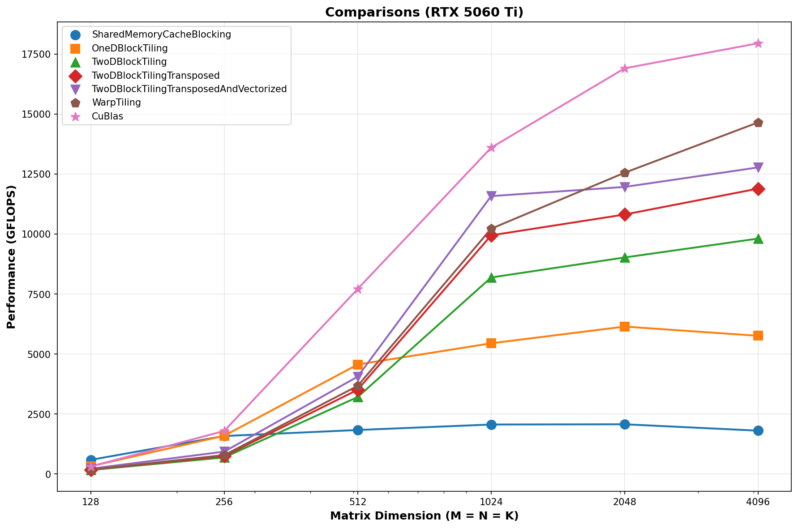

# Matrix Multiply

A collection of CUDA-based matrix multiplication examples with the sole intent of learning optimization techniques.

All work is based on Simon Boehm's original work [1] with some minor modifications. These involve,

* Relying on two dimensional arrays for shared and thread local data.
* Relying on explicit indexing within arrays, as opposed to pointer updates. The motivation for this was to fit my
mental model of how the algorithms works.
* A bit more descriptive naming of variables and macros. Again, to help with my mental model.
* A test runner class to encapsulate common code.

As with Simon's work, the GLOPS computation was borrowed from Wang Zhiyong [2].

The implementation was tested on the following setup,

* RTX 5060 T1
* CUDA 12.9
* Linux (Debian 11)

# Build Instructions

```
mkdir -p build && cd $-
cmake -DCMAKE_BUILD_TYPE=Release ..
make
```

# Results

The implementations were benchmarked on a RTX 5060 Ti.

Every result is the best of 25 iterations.



# References

1. [How to Optimize a CUDA Matmul Kernel for cuBLAS-like Performance: a Worklog](https://siboehm.com/articles/22/CUDA-MMM)
2. [wangzyon/NVIDIA_SGEMM_PRACTICE](https://github.com/wangzyon/NVIDIA_SGEMM_PRACTICE)
